<div align="center">

# IHHO-MS for Flexible Job Shop Scheduling

### Nature-Inspired Optimization: Improved Harris Hawks Optimization with Mycelial Search for Flexible Job Shop Scheduling under an Equal Evaluation Budget

**Van Van Chau**<sup>1,2</sup> · **Usa Klinsak**<sup>2</sup> · **Chinda Thorn**<sup>2</sup> · **Anderes Gui**<sup>3</sup> · **Minh Tuan Nguyen**<sup>1,*</sup> · **Phayung Meesad**<sup>2,*</sup>

<sup>1</sup> Faculty of Information Technology, Posts and Telecommunications Institute of Technology, Ho Chi Minh City, Viet Nam<br>
<sup>2</sup> Faculty of Information Technology and Digital Innovation, King Mongkut's University of Technology North Bangkok, Bangkok, Thailand<br>
<sup>3</sup> School of Information Systems, Bina Nusantara University, Jakarta, Indonesia<br>
<sup>*</sup> Corresponding authors

Research article submitted to *SN Computer Science* (Springer Nature), 2026

   

</div>

---

## Contents
[Abstract](#abstract) · [Contributions](#contributions) · [Method](#method) · [Experimental protocol](#experimental-protocol) · [Results](#results) · [What the results show and what they do not](#what-the-results-show-and-what-they-do-not) · [Reproducing the study](#reproducing-the-study) · [Repository layout](#repository-layout) · [Data and license](#data-and-license) · [Citation](#citation)

## Abstract
Nature-inspired metaheuristics turn the behaviour of animals and organisms into search rules. Harris hawks optimization (HHO) follows the cooperative surprise pounce of Harris's hawks. Mycelial Search (MS) follows a fungal mycelium, whose hyphae grow, fuse and reinforce nutrient routes. This study combines the two for the flexible job shop scheduling problem (FJSP), which couples operation sequencing with machine assignment. The improved HHO with MS (IHHO-MS) hunts with discrete hawk moves on a two-layer schedule encoding from a mixed heuristic start. Its best hawks then grow as mycelial tips along critical-path moves. A calibration on six instances with separate seeds set the tip count and growth length. IHHO-MS was compared with random-key implementations of HHO, binary HHO (BHHO), the grey wolf optimizer (GWO) and the whale optimization algorithm (WOA), and with a max-min ant colony optimizer (ACO). Every method had 50,000 schedule evaluations and 30 runs on each of 31 Brandimarte and Barnes instances. IHHO-MS beat the four random-key methods on every instance, and ACO on 26 instances with one loss, at about one fifth of its CPU time. The 25 held-out instances agreed. Removing MS cost the most, and the critical-path growth of its tips gave most of the gain. Results without the hawk moves or without any one graph mechanism of MS stayed within a preset equivalence margin, but without both they fell significantly behind on average, so the two layers back each other up. As only IHHO-MS used problem-specific operators, the results rank implementations, not metaphors.

## Contributions
1. **A discrete Harris hawks optimizer for the FJSP.** Exploration, soft besiege, hard besiege and rapid dives act through job-level and operation-level inheritance on a two-layer schedule encoding, driven by the number of evaluations used.
2. **A discrete Mycelial Search for schedules.** The ten best hawks become tips that exchange schedule segments through a fusion graph with Louvain communities, potential-gated flow, cord plasticity and anchor injection, and grow along critical-path moves.
3. **A strict equal-budget comparison.** Six implementations share one decoder and one budget of 50,000 schedule decodes, with every local-search decode counted; the calibrated setting is confirmed on 25 instances held out from calibration and read again at equal CPU time.
4. **Ablations that locate the gain.** Removing components one at a time, including a hawk-free control, under an equivalence margin fixed before those runs.

## Method
<p align="center">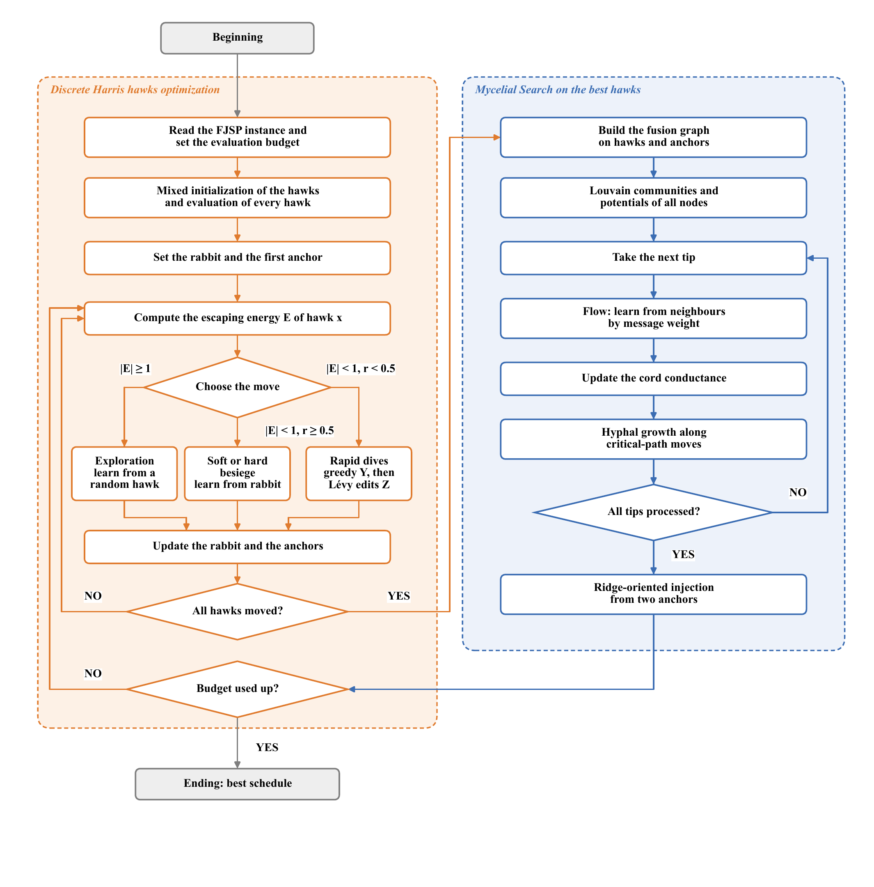</p>
<p align="center"><em><b>Figure 1.</b> Flowchart of IHHO-MS.</em> <a href="figures/fig1_framework.pdf">[PDF]</a></p>

<p align="center">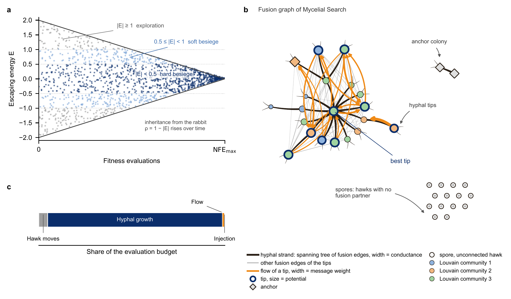</p>
<p align="center"><em><b>Figure 2.</b> Hawk phases, a fusion-graph snapshot from one run and the budget split.</em> <a href="figures/fig2_hybrid_strategy.pdf">[PDF]</a></p>

<p align="center">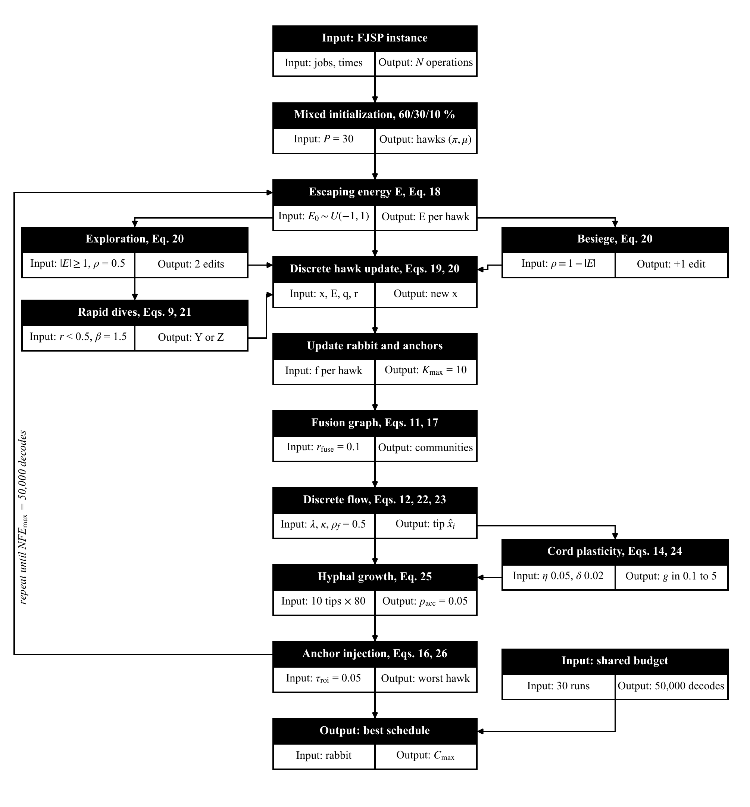</p>
<p align="center"><em><b>Figure 3.</b> Parameter architecture of IHHO-MS.</em> <a href="figures/fig3_parameter_architecture.pdf">[PDF]</a></p>

| Script | Purpose |
|---|---|
| `fjsp_hho.py` | Instance parser, active decoder, schedule checker, critical-path moves, IHHO-MS, its variants and the five baselines; command-line runner |
| `analyze.py` | Per-instance statistics, Holm-corrected rank-sum tests, Friedman ranks and signed-rank tests |
| `extra_stats.py` | Vargha–Delaney effect sizes, bootstrap intervals, CPU time and the equal-CPU-time reading |
| `analyze_controls.py` | Hawk-free controls and one-at-a-time ablation with the equivalence test |
| `calibration_stats.py` | Mean ranks, Friedman test and Kendall's W of the two calibration grids |
| `verify_results.py` | Every value of Tables 4–7 and 9 of the paper against the raw runs |
| `tests/test_fjsp.py` | Decoder, checker, moves and the Louvain routine |

## Experimental protocol
| Setting | Value |
|---|---|
| Benchmarks | 10 Brandimarte (MK01–MK10) and 21 Barnes instances |
| Budget | 50,000 schedule decodes per run; local-search, flow and injection decodes included |
| Runs | population 30; 30 runs per instance and method, seeds 0–29 |
| Baselines | HHO, GWO and WOA on random keys; binary HHO with a V-shaped transfer function; max–min ant system |
| IHHO-MS setting | 10 tips with 80 decodes each, chosen on six instances with seeds 100–109 and confirmed on all 31 |
| Tests | two-sided rank-sum per instance with Holm correction; Friedman and signed-rank across instances; Vargha–Delaney A<sub>12</sub> |
| Measure | relative percentage deviation RPD = 100 (C − UB) / UB from the reference value UB of each instance |

The repository holds 14,880 comparison and ablation runs and 3,000 calibration runs. Every run file stores the final makespan, CPU time, a 100-point convergence curve, population diversity, the activity statistics of Mycelial Search and the best schedule, which the checker re-verified.

## Results
### Comparison under equal decode budgets
| Method | Mean RPD Brandimarte, % | Mean RPD Barnes, % | IHHO-MS W/T/L, all 31 | IHHO-MS W/T/L, held-out 25 | Friedman mean rank | CPU s per run |
|---|---:|---:|---:|---:|---:|---:|
| HHO | 42.55 | 13.39 | 31/0/0 | 25/0/0 | 4.55 | 33.0 |
| BHHO | 41.94 | 13.11 | 31/0/0 | 25/0/0 | 4.16 | 49.4 |
| WOA | 47.21 | 16.22 | 31/0/0 | 25/0/0 | 5.97 | 31.7 |
| GWO | 38.51 | 9.82 | 31/0/0 | 25/0/0 | 3.29 | 37.5 |
| ACO | 10.36 | 8.18 | 26/4/1 | 20/4/1 | 1.98 | 350.9 |
| IHHO-MS (proposed) | 6.13 | 6.13 | – | – | 1.05 | 65.0 |

W/T/L counts the instances where IHHO-MS was significantly better, not different, or worse by the Holm-corrected rank-sum test. Mean RPD uses the per-instance mean makespan rounded to one decimal, as printed in the paper.

<p align="center">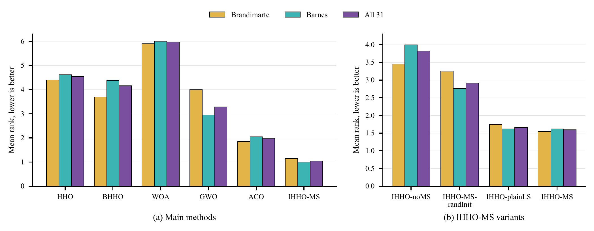</p>
<p align="center"><em><b>Figure 4.</b> Mean Friedman ranks of the methods on each benchmark set.</em> <a href="figures/fig4_friedman_ranks.pdf">[PDF]</a></p>

<p align="center">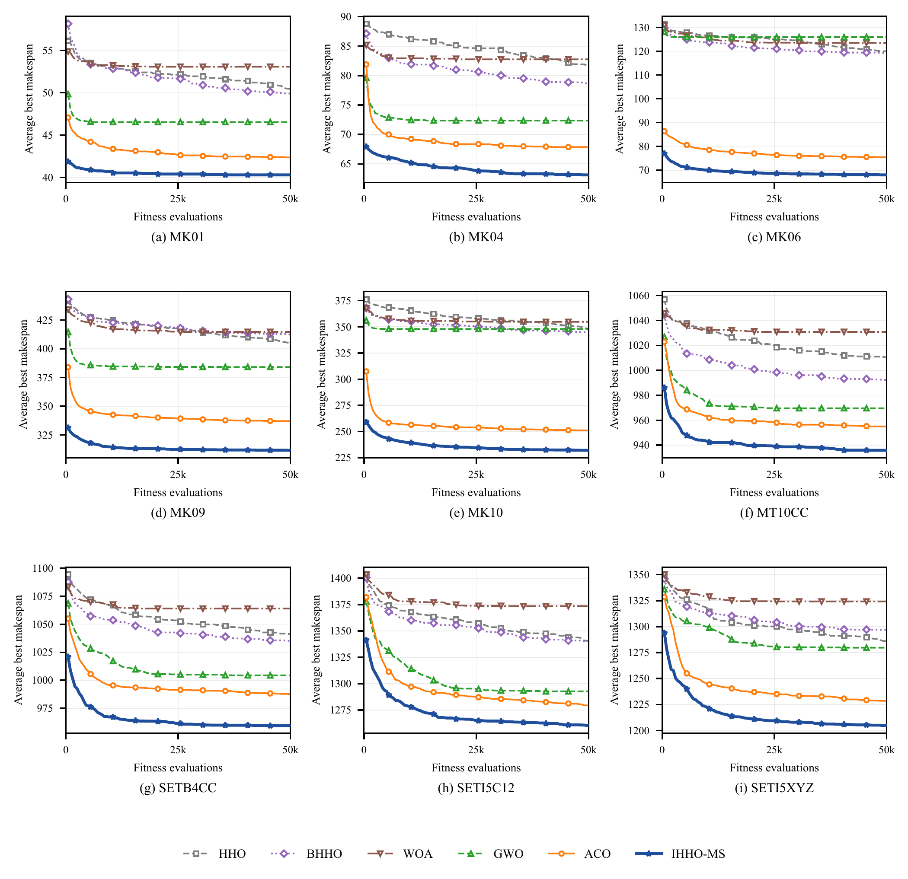</p>
<p align="center"><em><b>Figure 5.</b> Convergence curves of the compared methods on representative instances.</em> <a href="figures/fig5_convergence.pdf">[PDF]</a></p>

<p align="center">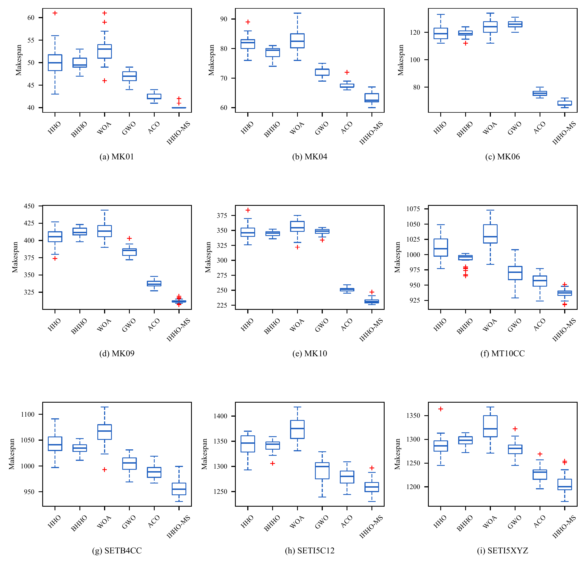</p>
<p align="center"><em><b>Figure 6.</b> Box plots of final makespans on representative instances.</em> <a href="figures/fig6_boxplots.pdf">[PDF]</a></p>

### Reading the same runs at equal CPU time
| Against | HHO | BHHO | WOA | GWO | ACO |
|---|---:|---:|---:|---:|---:|
| IHHO-MS W/T/L at equal CPU time | 31/0/0 | 31/0/0 | 31/0/0 | 31/0/0 | 29/1/1 |

The slower method of each pair was stopped at the CPU time of the faster one, at the matching point of its recorded convergence curve.

### Ablation
| Variant | What it removes | Mean RPD Brandimarte, % | Mean RPD Barnes, % | IHHO-MS W/T/L |
|---|---|---:|---:|---:|
| IHHO-noMS | Mycelial Search | 10.78 | 9.62 | 29/2/0 |
| IHHO-MS-randInit | heuristic initialization | 10.63 | 6.81 | 13/17/1 |
| IHHO-plainLS | graph exchange of MS, replaced by a plain critical-path search of equal size | 6.24 | 6.15 | 0/31/0 |
| IHHO-MS (proposed) | – | 6.13 | 6.13 | – |

Over the 31 instances, the mean RPD of IHHO-MS minus that of the plain local-search variant was -0.05 points, 95% bootstrap interval [-0.18, +0.08].

<p align="center">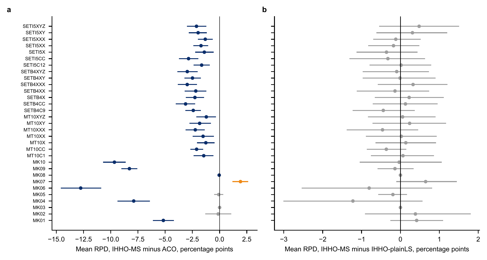</p>
<p align="center"><em><b>Figure 7.</b> Per-instance gap in mean RPD with 95% bootstrap intervals.</em> <a href="figures/fig7_paired_differences.pdf">[PDF]</a></p>

### Hawk-free controls and one-at-a-time ablation of MS
| Variant | What it removes | RPD gap, IHHO-MS minus variant | 95% interval | Within ±0.5 | IHHO-MS W/T/L | Signed-rank p, Holm |
|---|---|---:|---:|:---:|---:|---:|
| IHHO-MS-noFlow | flow and jitter | +0.07 | [-0.10, +0.22] | yes | 1/30/0 | 0.920 |
| IHHO-MS-noCord | cord plasticity | -0.05 | [-0.21, +0.10] | yes | 0/31/0 | 1.000 |
| IHHO-MS-noInject | anchor injection | -0.02 | [-0.21, +0.16] | yes | 0/31/0 | 1.000 |
| IHHO-MS-noComm | Louvain communities | +0.02 | [-0.17, +0.20] | yes | 0/31/0 | 1.000 |
| IHHO-MS-noHawk | hawk moves | +0.08 | [-0.12, +0.26] | yes | 2/29/0 | 0.058 |
| CPLS-elite | hawk moves and the whole graph exchange | -0.32 | [-0.55, -0.11] | no | 4/27/0 | 0.022 |

A negative gap favours IHHO-MS. "Within ±0.5" means that the 90% bootstrap interval of the gap lies inside ±0.5 RPD points, the equivalence margin fixed before these runs.

### How the components share the work
<p align="center">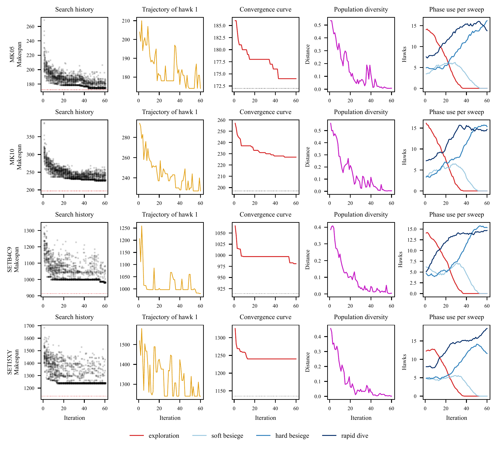</p>
<p align="center"><em><b>Figure 8.</b> Four of the eight instrumented IHHO-MS runs.</em> <a href="figures/fig8_qualitative.pdf">[PDF]</a></p>

<p align="center">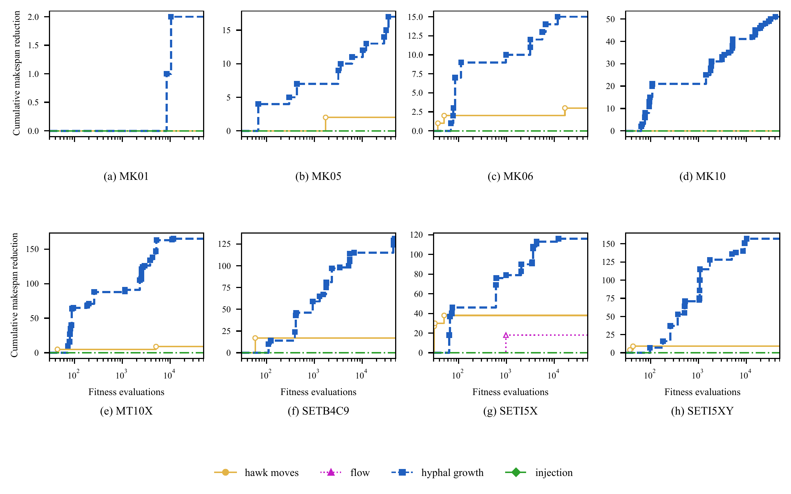</p>
<p align="center"><em><b>Figure 9.</b> Share of best-schedule gains by component in eight instrumented runs.</em> <a href="figures/fig9_driver_score.pdf">[PDF]</a></p>

<p align="center">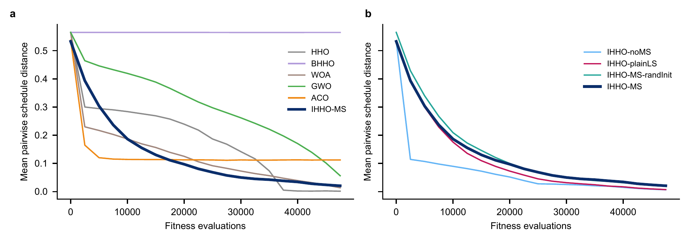</p>
<p align="center"><em><b>Figure 10.</b> Mean pairwise schedule distance in the population over the budget.</em> <a href="figures/fig10_diversity.pdf">[PDF]</a></p>

<p align="center">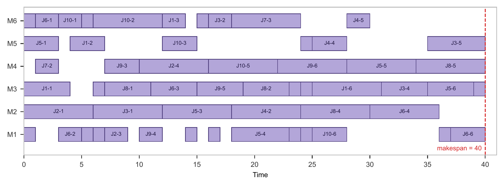</p>
<p align="center"><em><b>Figure 11.</b> Optimal MK01 schedule found by IHHO-MS with makespan 40.</em> <a href="figures/fig11_gantt_mk01.pdf">[PDF]</a></p>

### Calibration
Grid A, number of tips n_tip x growth length L_g: best cell 10 tips × 80 decodes, mean rank 1.67; the initial setting ranked 21 of 25; Friedman p = 1.5e-14, Kendall's W = 0.826. Grid B, fusion radius r_fuse x flow rate rho_f: Friedman p = 0.18, Kendall's W = 0.21, so the initial values were kept.

<p align="center">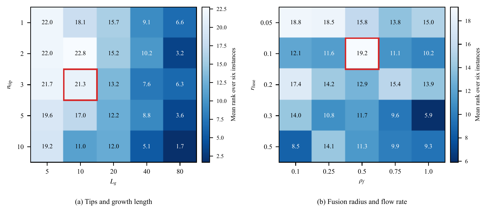</p>
<p align="center"><em><b>Figure 12.</b> Mean ranks of the calibration grids over six instances.</em> <a href="figures/fig12_sensitivity.pdf">[PDF]</a></p>

## What the results show and what they do not
- **Shown.** Under equal decode budgets IHHO-MS outperformed the random-key HHO, binary HHO, GWO and WOA on every instance and the max–min ant system on most of them, also at equal CPU time and on the instances held out from calibration.
- **Shown.** Mycelial Search matters most: removing it cost more than removing any other component, and the critical-path growth of its tips supplies most of the improvement.
- **Shown.** The hawk moves and the graph exchange back each other up. Each could be removed with the other in place without a detectable loss, but an elite critical-path search without both fell significantly behind on average.
- **Not shown.** A separate benefit of the fusion graph over a plain critical-path search of equal size while the hawks are present.
- **Scope.** Only IHHO-MS and its variants use a heuristic start and critical-path moves, and the baselines were not calibrated; the comparison therefore ranks these implementations, not the underlying metaphors. The budget of 50,000 decodes is small compared with the strongest published solvers.

## Reproducing the study
Python 3.10 or newer and the pinned packages:

```bash
pip install -r requirements.txt
bash run_all.sh        # rebuilds every analysis file from the raw runs and checks the paper's tables, about a minute
```

`verify_results.py` recomputes every value printed in Tables 4–7 and 9 of the paper from the raw runs and compares it at the printed precision; it reports the number of values checked and exits with an error on any mismatch. A single experiment run, for example IHHO-MS on MK01 with seed 0:

```bash
python fjsp_hho.py --data data/brandimarte --instances MK01 --algos IHHO@nt10_lg80 --seeds 0 --nfe 50000 --out out.jsonl
```

Runs are deterministic for a given instance, method and seed, so this reproduces the stored schedule. Arm names on the command line: `IHHO@nt10_lg80` is IHHO-MS, stored as `IHHO` in `results/proposed`; `IHHO` is the initial setting, stored as `IHHO-init`; `IHHO-plainLS@nt10_lg80` and `IHHO-randInit@nt10_lg80` are the calibrated ablations, stored without the suffix. The commented block of `run_all.sh` lists the commands of the full study. CPU times depend on the machine.

## Repository layout
```
fjsp_hho.py, analyze.py, extra_stats.py, analyze_controls.py, calibration_stats.py, verify_results.py
tests/                          unit tests
data/brandimarte, data/barnes   benchmark files, checksums and reference values
results/
  proposed/runs.jsonl           main comparison and ablations, 10 arms x 31 instances x 30 seeds
  proposed/analysis/            per-instance statistics, tests, Friedman ranks, extra_stats.json
  controls/runs.jsonl           hawk-free controls and one-at-a-time ablation, 6 arms x 31 x 30
  controls/analysis/            controls_summary.json
  calibration/runs.jsonl        two 5 x 5 calibration grids on six instances, seeds 100-109
  calibration/summary.json      mean ranks, Friedman test, Kendall's W
  reported_tables.json          table rows as printed in the paper, read by verify_results.py
figures/                        figures of the paper, vector PDF; png/ holds the 300-dpi copies shown here
CHECKSUMS.sha256                SHA-256 of every data and result file
```

## Data and license
The Brandimarte and Barnes instances come from the public collection [SchedulingLab/fjsp-instances](https://github.com/SchedulingLab/fjsp-instances), MIT License; see `data/README.md` for the original sources and checksums. The code is released under the MIT License.

## Citation
If you use this code, please cite the article; `CITATION.cff` holds the metadata. The full reference will be added here once the article is published.

## Contact
Corresponding authors: Minh Tuan Nguyen, Posts and Telecommunications Institute of Technology, minhtuan@ptit.edu.vn; Phayung Meesad, King Mongkut's University of Technology North Bangkok, phayung.m@itd.kmutnb.ac.th
